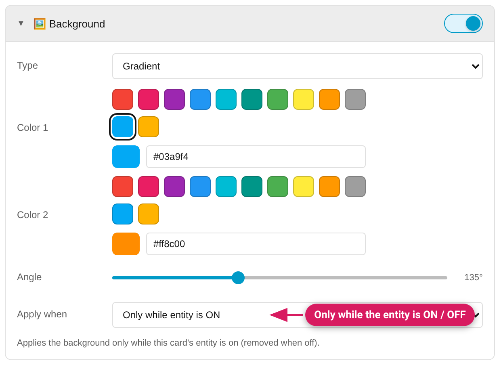

The visual-effect modules. All of them support state conditions via the
shared **"Apply when"** control where noted.

## Background

- **Solid color** or **gradient** (two colors + angle slider). The solid
  field takes one colour, or an image or a comma-separated list of layers
  (`url('/local/photo.jpg')`, `url(/local/x.png), red`); only the last layer
  of a list may be a plain colour, and what you type is checked — an invalid
  value is not saved. A `;` can't be typed (it would end the declaration), so
  a `data:` URI needs `%3B` in place of the `;`, or put the image in
  `/local/`.
- **Apply when**: always / only while the entity is ON / only while OFF /
  while *another* entity is ON — great for a "glow when active" effect. In
  the other state the card **keeps its own look** (its theme background): the
  Studio no longer writes `none`, which used to make the card transparent.
  A style saved with the older form is recognised and re-saved in the new one.
  "ON / OFF" isn't offered on a card without an entity of its own, or for an
  entity that is never on or off (lock, cover, alarm panel, person, timer,
  input button); climate and water heater offer OFF only. A card without an
  entity can still use "another entity".

## Visual Filters

CSS filter effects on the whole card:

- **Grayscale** — with its own Apply when (making inactive devices look
  "dead" is the classic use: grayscale *while OFF*). It starts as "Always"
  on cards where "while OFF" could never match (no entity, a sensor, a lock …)
- **Brightness** — 0–200%
- **Blur** — 0–20px
- **Opacity** *(since v0.9.0)* — 10–100%, fades the whole card
- **Transition speed** — how smoothly the filter animates on state change.
  On tile, sensor, entity and area cards, whose own stylesheet would
  otherwise override it, the Studio writes the transition with `!important`
  so filter changes fade instead of snapping; a `transition` you write by
  hand in [Advanced CSS](Advanced-CSS) still wins.

Since v0.9.0, brightness/blur/opacity share a **"Reacts to"**
condition (shown while grayscale is off — grayscale keeps its own control):
always / entity ON / entity OFF / another entity ON / **while a value
matches…** (entity or numeric attribute + operator + threshold). Example:
blur + fade a camera card only while the camera is off.

## Animation

A looping animation on the card:

| Preset | Effect |
|---|---|
| Pulse | Gentle rhythmic scale |
| Breathe | Soft opacity fade |
| Gradient-shift | Slowly shifts a gradient background (needs the Background module in gradient mode; left out where the card has no background to shift — picture cards, iframe, map, Bubble Card, the Mushroom title card) |
| Blink | Abrupt alert flash |
| Bounce | Periodic vertical bounce |
| Shake | Quick horizontal shake |
| Spin | Continuous rotation (constant speed; left out on thermostat, humidifier, light and map, where it drags the handle or the map away from the pointer) |
| Glow | Pulsing glow around the card |
| Heartbeat | Double-beat scale, like a heartbeat |

Animation is offered on every built-in card except heading, the energy
cards, activity, webpage and shopping list (v0.11.0-beta.3 added alarm panel,
calendar, gauge, history graph, humidifier, iframe, light, logbook, map, media
control, picture, picture elements, picture entity, picture glance, statistic,
statistics graph, thermostat, to-do list and weather forecast). A preset that
can't work on a card is left out of its list, and a preset you load from the
preset bar is dropped if the card can't use it.

Plus a **Duration** slider (seconds per cycle — lower is faster; it was
called "Speed" before v0.11.0-beta.3) and the trigger control: always / while the entity
is ON / OFF / while *another* entity is ON — or, since v0.9.0,
**"While a value matches…"**: pick an entity (or one of its numeric
attributes), an operator, and a threshold, and the animation runs only
while the condition holds. The classic attention-indicator: *glow while
`battery_level` < 15*, *pulse while the freezer is above −10°*.

## Border & Radius

- **Border radius** — round the card's corners (0–50px)
- **Border width** (0–8px) and **border color** — the color picker appears
  once width > 0
- **"Reacts to"** *(since v0.9.0)* — the border can appear only
  while a condition matches (entity ON/OFF, another entity ON, or a
  numeric value comparison), with an optional **"Width otherwise"**
  fallback; 0 means the card's own border. Example: a 3px red border while
  the freezer is above −10°, the card's normal border otherwise. The color is the same in both branches — for a
  state-driven border *color*, use Threshold Colors.

Combines well with [Threshold Colors](Threshold-Colors) targeting *Border
Color* — a value-driven colored frame (Threshold then supplies its own
border width control).

Not offered on containers (stacks paint no card box of their own — style the
children instead, see [Styling Cards Inside Stacks](Styling-Cards-Inside-Stacks)).
