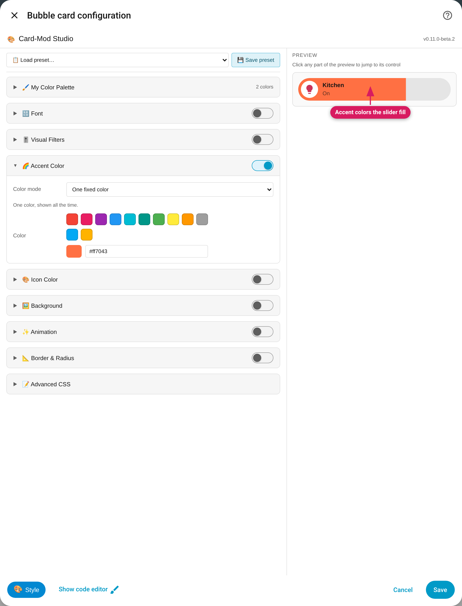

[Bubble Card](https://github.com/Clooos/Bubble-Card) (`type: custom:bubble-card`) — **new in 0.11 (beta)**. Four kinds of Bubble card have their own set of controls, each one wired to the part of the card it actually reaches; controls with nothing to reach are hidden.

> Beta: Bubble Card support first shipped in v0.11.0-beta.2. It was measured on
> **Bubble Card 3.4.3** (the 3.x line), **HA 2026.11.0**, **card-mod 4.2.1**
> and **UIX 9.0.0** (identical on both engines): the module-effect audit finds
> no control that changes nothing on any of the four kinds. Bubble's class
> names are tracked per major version — a later major gets its own audit
> before the Studio adopts it.

*Bubble slider button: Accent colors the slider fill.*

## Which cards

Bubble picks its kind with `card_type:`. The Studio recognises:

| Kind | In YAML |
|---|---|
| **Button** | `card_type: button` |
| **Slider button** | `card_type: button` with `button_type: slider` |
| **Separator** | `card_type: separator` |
| **Cover** | `card_type: cover` |

**Any other `card_type`** (and a Bubble card with no `card_type`) is not covered yet: it keeps showing every module, as an unknown custom card does — with a notice that some controls may not reach the card (v0.11.0-beta.3) — and may need [Advanced CSS](Advanced-CSS). Pop-up cards open Bubble's own editor, so the Studio isn't reachable there.

## Available options

| Module | Button / slider button / cover | Separator | What it styles |
|---|---|---|---|
| Font | ✅ | ✅ (name only) | The **name** and the **state** text: size, weight, family and colour. A separator has a name and no state. Hidden when neither is shown: `show_name: false` without a state line (Bubble shows one for `button_type: state`, `show_last_changed`, `show_last_updated`, a shown attribute or `state_content`) |
| Icon Color | ✅ | ✅ | The icon's colour, plus an **Icon size** slider that stops where the icon still fits (50px, 56px in the large layout; separator 40px, 33px large). The default mode is "Keep the card's colour". Hidden with `show_icon: false` |
| Background | ✅ | ✅ | The card's visible box — the pill (button), the cover card's background, or the separator's box. Bubble leaves the button background at half opacity, so the Studio sets it to full opacity along with your colour. On a slider button the Background sits **under** the fill, so the fill stays visible |
| Border & Radius | ✅ | ✅ | Border and corner radius, drawn around the whole card; the radius also works in the large layouts (`card_layout: large`, `large-2-rows`, sections views) |
| Accent Color | slider button only | — hidden | The **slider's fill** (and its opacity) |
| Threshold Colors | — hidden | — hidden | Nothing reachable to colour from a value |
| Visual Filters, Animation | ✅ | ✅ | The whole card |
| Advanced CSS | ✅ | ✅ | Anything else |

Why those are hidden: Bubble's own `ha-card` is transparent, so Accent has no accent colour to recolour — except the slider fill — and none of Threshold's colour targets reaches a visible part. Hand-written CSS for those stays in [Advanced CSS](Advanced-CSS).

## Card-specific behavior

- **Border and Background go on the visible box.** A border on Bubble's outer `ha-card` would draw a second, separate frame next to the real pill, so the Studio writes them inside it: the border and radius on Bubble's own clipping container (so the whole card shows the border), the Background under a slider's fill. Styles written by v0.11.0-beta.2 are recognised and saved in this form the next time you save the card.
- **Animation:** Gradient Shift isn't offered on Bubble cards: the background is painted on an inner element, so the shifting gradient wouldn't move.
- **Stack children** are named by their kind ("Bubble slider", "Bubble button") in the child header.
- **Accent on a slider button colours the fill only.** Turn on Accent Color, pick a colour, and the filled part of the slider changes — nothing else on the card.
- **A separator has no entity.** There's no state to read on it, so for state-driven colours use the **Controlled by** picker, as on any entity-less card.
- **A cover card has buttons, no slider.**

## Your own Bubble `styles:` and the Studio

Bubble has its own `styles:` option. The Studio **never writes it and never changes it** — whatever you wrote there is preserved untouched. The two work side by side, with this precedence when both style the same part (measured on both engines):

| Situation | Winner |
|---|---|
| Same part, same specificity, plain or `!important` | **The Studio** — card-mod/UIX's style comes after Bubble's own |
| Your `styles:` rule is `!important`, the Studio's is plain | **Yours** |
| Your `styles:` rule uses a more specific selector (e.g. `.bubble-container .bubble-name`) with `!important` against the Studio's `!important` | **Yours** (specificity) |
| Your rule is plain, the Studio's is `!important` | **The Studio** |

The Studio writes `!important` only where Bubble's own rule would otherwise win: the icon colour, the slider fill and the button background's opacity (and, on a separator, its corner radius). If you want your own `styles:` value to win for a part, give it `!important`, or turn the matching Studio control off. Hand-written `!important` rules in the card's `card_mod:`/`uix:` stay in [Advanced CSS](Advanced-CSS) and win over the controls as usual (the module shows its ⚠️ warning).

## Click-to-edit

Point at the preview and the highlight names the control that styles that part; a click jumps to it.

- The **name** and **state** text → Font, but only over the words themselves
- The **icon** and its circle → Icon Color
- A slider's **fill** (the visible filled part) → Accent
- Everything else inside the card — the empty pill, the unfilled track, a cover's arrow buttons → Background

## Limits

- **Tested versions:** Bubble Card 3.4.3 (3.x) on HA 2026.11.0 with card-mod 4.2.1 and UIX 9.0.0 (v0.11.0-beta.2). v0.11.0-beta.3 was re-verified on HA 2026.11.0 with both engines (the 4 kinds, 0 controls without effect) and with real input on HA 2026.2.3 and 2025.9.4 (Bubble Card 3.4.2 there).
- **Other Bubble card types** (any `card_type` besides button, separator and cover) keep showing every module for now, so some controls there may do nothing.
- **Later Bubble majors:** the controls were measured on Bubble 3.x only; a new major can change Bubble's internals and needs a fresh audit.

See also: [Mushroom](Mushroom-Cards) · [Card Support & Limits](Card-Support).
