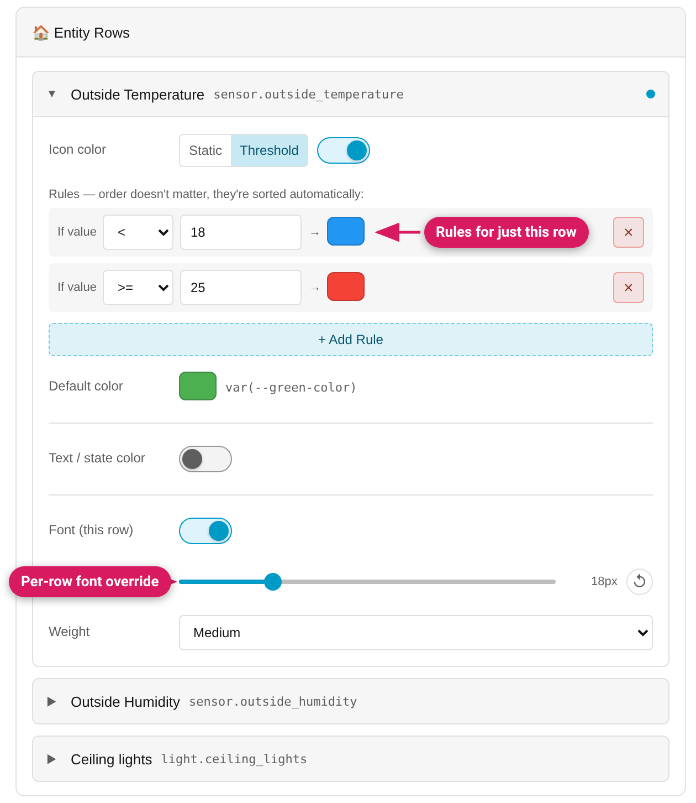

`type: entities` cards get an **Entity Rows** section — one collapsible
styling section per row, because card-level icon/text styling can't reach
into individual rows (each row is its own shadow-DOM element).



## Per row, you can style

- **Icon color** — *Static* (a fixed color) or *Threshold* (the same
  first-match-wins rule builder as the card-level
  [Threshold Colors](Threshold-Colors), evaluated against this row's entity)
- **Text / state color** — Static or Threshold, same way
- **Font (this row)** — a text size + weight override, layered on top of the
  card-level [Font module](Font-and-Text). Its switch only reveals the
  controls: size starts at "Default" and weight at "Default", and nothing is
  written until you set one (switching it off clears both)

A dot on the row header marks rows that carry styling. Each row is labelled
the way HA labels it: on HA 2026.11 and newer that is HA's own text for the
row (it follows HA 2026.11's naming of device and entity); on older HA it
falls back to the row's `name:`, then the entity's friendly name, then the
entity id. When two rows would get the same label they are numbered
("Lamp (1)", "Lamp (2)"). Section, divider and link rows have no styling
controls and say so. Pointing at a row in the live preview names it too
("Entity Rows — Living room lamp").

## Row forms — both work

```yaml
entities:
  - sensor.temperature          # bare-string shorthand
  - entity: sensor.humidity     # object form
    name: Humidity
```

Bare-string rows are styleable too (since v0.8.0); they're converted to the
object form automatically the moment they gain styling, because only the
object form can carry a style block. Unstyled string rows are left untouched.
A row stays an `{entity: …}` object after its styling is removed again; it
isn't turned back into a string.

Saving never rewrites a row you didn't touch: its CSS, its key order and
options such as `state_color` stay exactly as they were. (Before
v0.11.0-beta.3 an unrelated save could rewrite every row.)

A row declaration you wrote with `!important` (`color`, `--state-icon-color`,
`font-size`, `font-weight`) is not read into the row's controls and is written
back unchanged when you edit the row (v0.11.0; earlier the flag was
dropped). If you then set the same thing with a row control, the row shows a
warning that your own CSS overrides it.

## The generated YAML

Row styles are written into each row's own `card_mod:`/`uix:` block:

```yaml
entities:
  - entity: sensor.temperature
    state_color: false
    card_mod:
      style: |
        :host {
          --state-icon-color: {{ '#ff0000' if states('sensor.temperature') | float(0) >= 25 else '#2196f3' }};
          font-size: 18px;
        }
```

`state_color: false` is HA's own per-row option. While an entity is *on*,
HA colours its icon itself (lights always do), and that colour wins over
any style — so without it a row icon colour would only show while the
entity is off. The Studio adds it when you set a row's icon color and
removes it again when you remove that color; rows whose icon color you
don't touch are left exactly as they are. A row colored before v0.10.0
shows an **Always use this color** button under its icon color that adds
it.

## Dictionary-form rows (v0.10.0)

A row whose style is written in card-mod's dictionary form (the `$`
shadow-piercing syntax) is editable too: its `.` entry is read into the
controls above and rewritten when you edit them, while every other entry in
that row's dictionary is preserved exactly as written. See
[Advanced CSS](Advanced-CSS#dictionary-form-styles-shadow-piercing) for how
dictionary-form styles behave.

A row that can't be rewritten faithfully — a plain style on one key plus a
*different* dictionary on the other, or a dictionary whose `.` isn't plain
CSS — shows a 🔒 lock note instead of controls, because edits there would be
dropped. It's preserved as-is; edit it in YAML. Other rows on the same card
stay editable.

Hand-written row CSS from *both* `card_mod:` and `uix:` is kept through an
edit, and a row rule aimed at part of the row (`state-badge`,
`hui-generic-entity-row`, …) is never turned into a whole-row rule.

## Also available inside stacks

An entities card nested in a vertical/horizontal stack or grid gets the same
Entity Rows section inside its child styling section — see
[Styling Cards Inside Stacks](Styling-Cards-Inside-Stacks).

## Current limitations

- A mixed-form row (see above) is preserved but not editable visually.
- The pierced entries of a dictionary-form row (everything except its `.`
  entry) are preserved verbatim but not editable visually.
