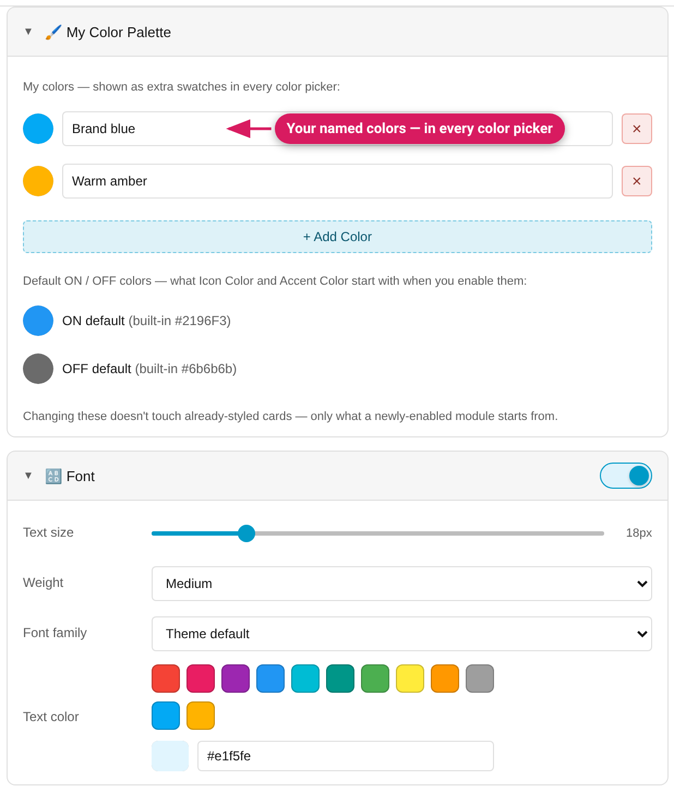

## The Font module

Text **size** (slider), **weight** (Normal / Medium / Bold), **family**
(Theme default / Sans-serif / Serif / Monospace / Custom… free text), and
**color** — for almost any card, not just headings.

**A control you don't touch writes nothing** (v0.11.0-beta.3). Switching the
module on changes nothing on the card by itself: the size slider starts at
"Default" (with the card's own size where it is known, e.g. "Default (14px)"
on a tile), weight starts at "Default", and the colour picker is empty. Only
what you set is written, so the text keeps the card's own size, weight and
theme colour. Each control has a way back to "not set" (the reset button, the
Default option, the clear button in the colour picker). A module that is on
but has nothing set isn't saved, so it opens switched off next time. Styles
saved earlier keep all the values they contain.

### Per-card behavior

Many HA cards override fonts internally, so a plain `font-size` on the card
would silently do nothing. The module emits the card-specific companion
selectors/variables each card actually needs — you don't have to know any of
this, it just works:

| Card | What follows the Font module |
|---|---|
| entities / markdown / glance rows | Everything (plain inheritance) |
| entities, glance, calendar, todo-list, shopping-list, logbook, statistic, history/statistics-graph, markdown, alarm-panel | …plus the **card title** (at 1.5× your chosen size — the header's native ratio) |
| glance, calendar, todo-list, shopping-list, logbook, history/statistics-graph, markdown, alarm-panel | **Weight** reaches the title through Home Assistant's normal-weight token. That token is used by other text too: the calendar's grid and events, the logbook entries and "Show more", the graph legends and tooltips and the alarm panel's state label and buttons change weight with it. (The entities card's weight reaches its title only.) |
| light | Name/state text and the brightness % |
| button | The label **and the state line** (size at 0.7875× your size — its native ratio — and the same colour; with `show_name: false` the state line is the only text) |
| sensor / entity / statistic | Name, unit, **and the big value** (value at 1.75× your size — its native ratio) |
| humidifier | Weight also reaches the mode label ("Humidifying") |
| picture-glance | Weight reaches the title |
| tile | Name and state text (via the tile's own font variables — HA 2026.2+; on HA 2025.9 these variables don't exist yet, so the tile text keeps its size/colour) |
| gauge | The title (also on older HA, where it's a different element); the value number follows **color**, and **Number size** sizes it (below) |
| thermostat | The title and mode label's size and weight; the big number follows **weight/color**, and **Temperature size** sizes it (below). The mode label ("Heating") keeps its own colour |

**Known trade-off for older styles.** Because Font now reaches this text, an
older Font style — or a hand-written `ha-card { color: … }`,
`font-weight` or `font-family` that looks exactly like one — is loaded into
the Font module, and the next save adds the extra declarations for the card.
That can change how the card looks: the state line of a button card takes the
Font colour too, and on the calendar, logbook and alarm panel the weight
reaches more than the title. If you don't want that, put your rule in
Advanced CSS in another form, or reset the control.

### Number size — gauge value and thermostat temperature (v0.11)

On gauge and thermostat cards the module has one more row with its own
switch. It is written only while the Font module is on: switching Number size
on switches Font on, and a card that already has one opens with Font on. A
preset with Font off keeps the card's own Number size.

- **Gauge → Number size**, 50–130 %: scales the box HA fits the value into
  (HA fits the number into that box, so a plain font size wouldn't show).
  **100 % is exactly the size Home Assistant draws**; a wide value such as
  "123 °C" stops growing a little before 130 % so it never touches the arc.
  Before v0.11.0-beta.3 the range went to 150 % and 100 % was about 10 %
  larger than Home Assistant's own number: a style saved then loads at the
  same percentage, is rewritten on the next save (a number set to 100 % looks
  about 10 % smaller for wide values) and anything above 130 % reads as 130 %.
- **Thermostat → Temperature size**, 24–96px (HA's default is 57px).

Both numbers sit inside nested shadow roots, so the Studio writes them as a
dictionary-form (`$` shadow-piercing) entry and keeps it editable. If the
card already has your own hand-written CSS for that number, the row shows as
locked and your CSS is [preserved](Advanced-CSS#dictionary-form-styles-shadow-piercing)
unchanged.

### Not offered on

`heading` (it has the dedicated module below), `iframe`/`webpage`/`map`
(no HA-templated text to style), and plain `picture` cards (no text).
Beyond those, some text isn't reached on some cards: the thermostat's mode
label keeps its state colour; calendar day names, the entities card's section
labels and links, and logbook and to-do list entries keep their own
size.

**Text color** is hidden (size/weight/family stay) where the card colours
its own text and a colour set here would never show: media-control, area,
picture-entity, picture-glance, picture-elements, date and alert (the last
two new in HA 2026.11) and, in the Threshold list, alarm-panel.
**Text size** is hidden where the card sizes its own text: area, humidifier,
picture-entity, picture-glance, weather-forecast, date and alert (measured
with the module-effect audit on HA 2026.6, 2026.10 and 2026.11).
**Weight** is hidden on area, date and alert, where it changed nothing.
A value stored on those cards by an older style is still shown so you can
reset it.

When Threshold Colors is setting the card's text colour, the Font module
says so: the text colour chosen here isn't used while the threshold is on.

### Mushroom and Bubble Card (new in 0.11, beta)

On [Mushroom](Mushroom-Cards) cards Font styles the primary and secondary
text (the chips card: chip text size/weight/family; the title card: the
title and, for the family, the subtitle). A set text size carries a matching
line height, so a larger size doesn't clip; a size at or below Mushroom's own
leaves the card at its normal height. Font is hidden where the card's options
remove the text (both text lines set to none). On [Bubble Card](Bubble-Card) buttons, separators and covers it styles
the name and state text; Font is hidden only when neither is shown.

## The Heading Style module

`heading` cards get their own module with the same text controls (size,
weight, family incl. Custom…, color) **plus** icon size, icon color, and
text alignment (left/center/right).

It works on both **Title** and **Subtitle** heading styles (v0.10.0 — the
module never reached Subtitle headings before), and on Home Assistant
2026.10's new heading markup. Details, and what happens to headings you
styled with an older version, are on the [Heading card](Heading-Card) page.

## Per-row fonts

On entities cards, each row can override text size and weight individually,
layered on top of the card-level Font module — see
[Entities Card Per-Row Styling](Entities-Card-Per-Row-Styling).
