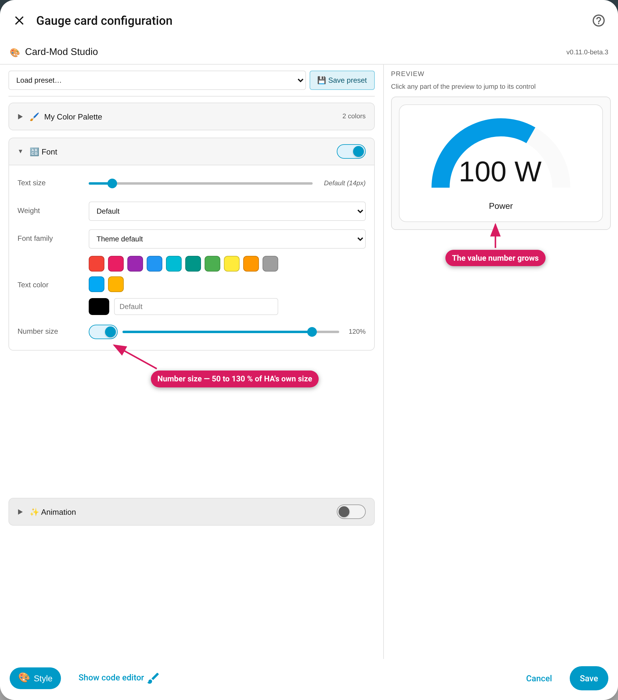

`type: gauge` — well supported, with the dial color as the star; since v0.11
the value number's size can be changed too.

*The Font module's Number size row makes the gauge's value number bigger.*

## Available options

| Module | Available | Notes on this card |
|---|---|---|
| Font | ✅ | Title: size/weight/color. Value number: color, and **Number size** (v0.11) |
| Visual Filters | ✅ | |
| Accent Color | ✅ | Labeled "Gauge / Accent Color" — colors the **dial's value arc** |
| Icon Color | — hidden | A gauge has no icon |
| Threshold Colors | ✅ | Enabling it defaults to the Accent property here; **Fade mode** gives a smoothly blending dial |
| Background | ✅ | |
| Animation | ✅ | Offered since v0.11.0-beta.3 (the gauge still opens its dialog while a preset runs) |
| Border & Radius | ✅ | |
| Advanced CSS | ✅ | |

## Card-specific behavior

- **The dial color:** HA writes its severity-computed color as an inline
  style on `<ha-gauge>` every render; the Studio targets `ha-gauge` with
  `--gauge-color: … !important`, which is the only thing that wins (v0.7.1
  fix — before that, gauge accent silently did nothing).
- **Needle gauges (`needle: true`):** there is no value arc — the accent
  colors the **needle and value text** instead, while the dial keeps
  showing your configured `segments`. The panel hints at this.
- **Fade thresholds on the dial** do what the gauge's own `severity`
  option can't: a continuous blue→green→red blend instead of hard steps.
- A gauge's entity has no on/off state — conditional color modes use the
  "Controlled by" picker.

## Limits

- **Number size** (Font module, v0.11) scales the box HA fits the value
  into — 50–130 % of HA's own size. 100 % is exactly what Home Assistant
  draws, and wide values such as "123 °C" stop growing a little earlier
  (about 112 %) so the number never touches the arc. It has its own switch in
  the Font module and is written, as a shadow-piercing (`$`) dictionary
  entry the Studio keeps editable, only while the Font module is on:
  switching Number size on switches Font on, and a card that already has the
  entry opens with Font on. If you already wrote your own `ha-gauge$` CSS,
  the control shows as locked and your CSS stays as it is.
- **Styles from beta.1 and beta.2** (which went up to 150 %, with 100 %
  about 10 % larger than Home Assistant's own number) load at the same
  percentage and are rewritten the next time you save: a number set to 100 %
  looks about 10 % smaller for wide values, and anything above 130 % reads as
  130 %.
