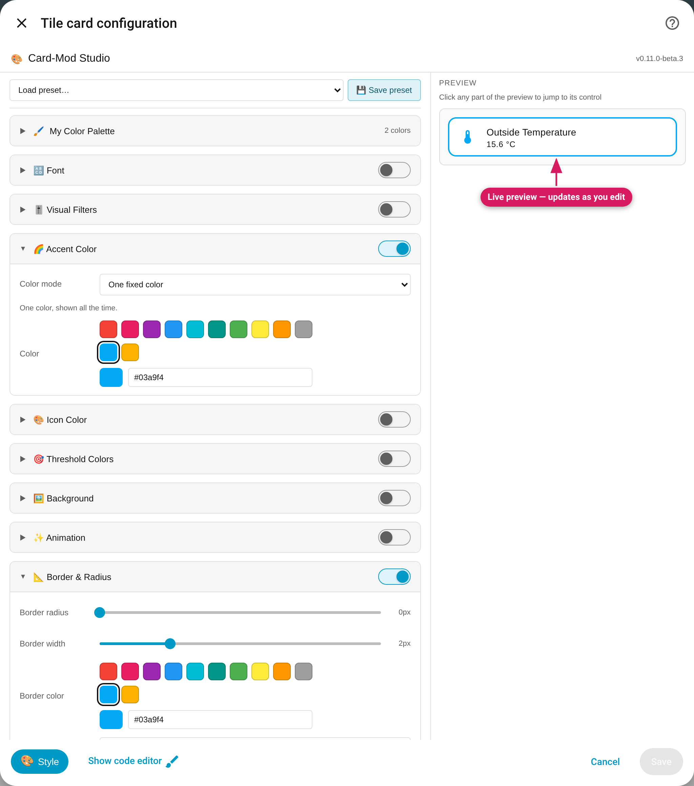

## Opening the panel

1. Edit any card (pencil icon in dashboard edit mode)
2. Click the **🎨 Style** button in the editor footer (icon-only on narrow
   screens)
3. The Card-Mod Studio panel opens in place of the card's normal config form



The layout:

- **Left column** — the preset bar, [My Color Palette](Presets-and-My-Color-Palette),
  and the style modules. Only modules that can actually do something on this
  card type are shown (see [Card Support](Card-Support)).
- **Right column** — a live preview of the real card that re-renders on every
  change, shown on your theme's own dashboard background. When the panel is
  narrower than about 720px (phones, small windows, tablet split view) the
  preview stacks below the controls instead.

The panel follows your theme in light and dark mode. Each module has a
**toggle** (enables its output) and a collapsible body. A module that's off
contributes nothing to the generated YAML, and a module that's on but where you
haven't set anything writes nothing either — Heading Style, Font and Icon
Color start from "Default", the card's own look.

**Using the keyboard.** Tab moves through the controls: a module header is a
button (Enter or Space opens and closes it) and its enable switch is the next
Tab stop. Every switch, slider, selection list and colour field has a name a
screen reader reads out. A row of colour swatches is one Tab stop — use the
arrow keys, Home and End to move along it. Enter in a field commits the value
and stays in the Studio. The live preview is deliberately not reachable with
Tab and can't be operated: neither keys nor clicks reach your real entities.
On a touch screen the controls are larger, and a vertical swipe that starts on
a slider scrolls the panel.

**Not sure which control styles what?** Since v0.9.0, just point at it:
hovering a part of the preview shows a highlight box naming the control that
styles that element (on an entities card, "Entity Rows — " plus the row's
label), and clicking jumps straight to it. A part that nothing styles names the
card's **Background** (or **Border**, or **Visual Filters**, on cards where
Background is hidden). Click-to-edit works on the card itself and on its
parts, but not on the children of a stack in the preview.

**Show code editor.** The Studio covers both of HA's editors; pressing HA's
"Show code editor" (or "Show visual editor") closes the Studio so you can see
the YAML — click **Style** to come back.

**Custom cards.** On a `custom:` card the Studio has no profile for (anything
other than Mushroom and Bubble Card's button, separator and cover), a notice
says some controls may not reach the card; Advanced CSS always works.

## Saving

There is no separate save step — the Studio writes into the card's config as
you edit, and you save with the editor's normal **Save** button. Cancel
discards everything, exactly like any other card edit.

## What actually gets saved

The Studio serializes your settings to CSS (+ Jinja2 templates for anything
state-driven) under the card's `card_mod:` key — or `uix:` when UIX is the
only engine installed (see [card-mod vs UIX](card-mod-vs-UIX)). Example — a
tile with an accent color and a border:

```yaml
type: tile
entity: sensor.outside_temperature
card_mod:
  style: |
    ha-card {
      --accent-color: #03a9f4;
      --tile-color: #03a9f4 !important;
      border: 2px solid #03a9f4;
    }
```

You can inspect it any time via **Show code editor** — the generated YAML is
plain card-mod/UIX syntax with no runtime dependency on Card-Mod Studio.
**If you uninstall the Studio, every styled card keeps working** — the engine
(card-mod/UIX) is what renders the styles.

## Editing cards that already have styles

Opening a card that carries hand-written `card_mod:`/`uix:` CSS pre-fills the
controls: everything the Studio recognises becomes editable module state —
including well-known *equivalent* phrasings (icon-color variables,
`ha-icon { color }`, `background-color`, and the shapes very old Studio
versions generated), which are adopted into the matching control and
rewritten in current syntax the moment you edit them. Anything it doesn't
fully understand is preserved verbatim in [Advanced CSS](Advanced-CSS) —
unrecognised styling is never reinterpreted or deleted, and if it overrides
an enabled control, that control tells you so with a ⚠️ warning.

Cards written in card-mod's **dictionary form** (the `$` shadow-piercing
syntax) are editable too: the `.` entry — the CSS for the card itself — drives
the normal controls, and every other entry is kept exactly as written. See
[Advanced CSS](Advanced-CSS#dictionary-form-styles-shadow-piercing).
