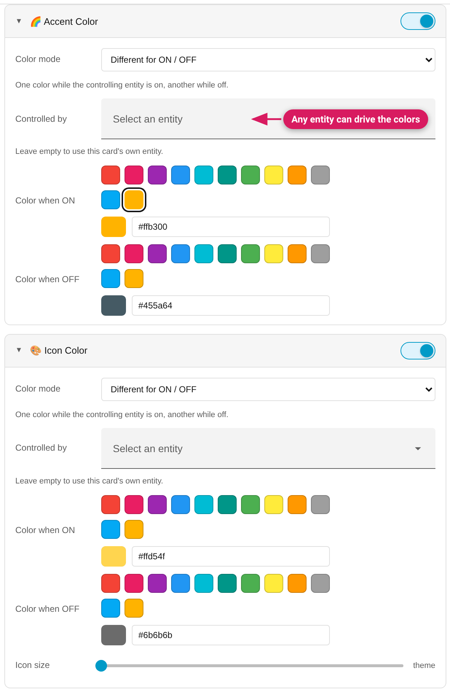

Two closely related modules for the card's main colors.

## Icon Color

Colors the card's main icon (`ha-state-icon`). Modes:

- **Keep the card's colour** *(cards with an Icon size slider)* — writes no
  colour at all, so you can change only the icon size. It's what a newly
  switched-on module starts in on those cards.
- **One fixed color** — always the same color.
- **Different for ON / OFF** — one color while the controlling entity is on,
  another while off (a Jinja2 condition is generated).
- **Match the light's color** *(light cards only)* — while on, the icon
  follows the light's real `rgb_color` attribute; you pick the off color. An
  empty off colour stays empty, and a hand-written template whose fallback
  the Studio can't read is left in Advanced CSS as written.

### Icon size *(since v0.9.0)*

On **tile, entity, sensor, statistic and picture-glance** cards — and on
[Mushroom](Mushroom-Cards) and [Bubble Card](Bubble-Card) cards (new in 0.11,
beta) — the module also offers an **Icon size** slider (theme default up to
a card-specific maximum, see below). It can be
static, or react to a condition — entity ON/OFF, another entity ON, or a
numeric value comparison — with a **"Size otherwise"** fallback (24px, the
HA default, unless changed). Example: the alarm card's icon grows while
armed.

The slider stops where the card still fits the icon: **tile 36px** (the
icon's circle grows with the glyph, three halves of its size, and a taller
tile overflows its row), **picture-glance 40px**, **Mushroom 56px**,
**Bubble Card 50px** (56px with the large layout; a separator 40px, 33px
large) and 64px elsewhere. A larger size already stored on a card stays
visible so you can reset it. On a tile, a size above 24px also enlarges the
circle: a tile styled with a bigger size before v0.11.0-beta.3 looks bigger
after the next save.

It's only offered where live probing shows the size variables reach
exactly the main state icon. Deliberately absent: button (use the card's
native `icon_height` option), light and media-control (the variable only
reaches their more-info button icon), alarm-panel and glance.

## Accent Color

The card's "theme" color. What it actually paints depends on the card type —
the module emits the right variable(s) per card:

| Card | What accent colors |
|---|---|
| tile | The tile color (icon + state text tint), incl. tile features like bar gauges |
| statistic | The card's one icon (also available as Icon Color, which also sets its size) |
| gauge | The dial's value arc — or with `needle: true`, the needle + value text |
| sensor | The graph line |
| calendar | The calendar's accent — HA 2026.10 reads `--primary-color` there, which the Studio writes (older HA keeps working through the old variable) |
| history-graph | The first graph line — HA 2026.10 reads `--graph-color-1` there, which the Studio writes too (older HA keeps working) |
| [Mushroom](Mushroom-Cards) cards | The card's active colour (icon, shape, light slider) — hidden when the card sets its own `icon_color` |
| [Bubble](Bubble-Card) slider button | The slider's fill |
| everything else | `--accent-color` and the state icon color |

Modes: **One fixed color** or **Different for ON / OFF**, same as Icon Color.

## "Controlled by" — drive colors from a different entity

In ON/OFF mode, the condition doesn't have to come from the card's own
entity. The **Controlled by** picker accepts any toggleable entity — e.g. a
button card whose icon reflects a separate status sensor. Leave it empty to
use the card's own entity. If the card's own entity has no on/off state
(e.g. a plain sensor), the panel warns you to pick one.

What "ON / OFF" can match depends on the entity:

- **No entity on the card** (entities, glance, markdown, heading, picture,
  area, …): there is nothing to watch, so "Different for ON / OFF" writes no
  colour until you pick an entity under "Controlled by" (a newly switched-on
  Icon Color starts as a fixed colour there).
- **Never on or off** — lock, cover, alarm panel, person, timer, input
  button: the ON colour could never show, so ON / OFF isn't offered; the
  panel says the ON colour never shows and suggests another entity or
  Threshold Colors.
- **Off only** — climate and water heater: their state can be `off` but never
  `on`, so OFF is offered, ON never matches.
- Humidifier, siren and remote count as on/off entities.

A style stored with an ON condition still shows and isn't rewritten.

## Notes

- On cards where the icon size is the point, the colour stays untouched until
  you pick a mode other than "Keep the card's colour".
- Fresh modules start from your **ON/OFF default colors** if you've set them
  in [My Color Palette](Presets-and-My-Color-Palette).
- Want the color to follow a *numeric value* instead of on/off? That's
  [Threshold Colors](Threshold-Colors) — it can drive icon and accent color
  (and more) from the same rule set.
- Some cards have no reachable icon (see [Card Support](Card-Support)) — the
  Icon Color module is hidden there rather than showing a dead control.
- Likewise, **Accent Color is only offered on cards that actually draw with
  the accent colour** — not on button, light, glance, markdown, humidifier,
  alarm panel, area, picture, map, iframe, to-do list, logbook, statistics
  graph, weather, date or alert cards (the last two are new in HA 2026.11), where switching it on changed nothing (checked
  pixel by pixel on every card, with card-mod and UIX). On a light card use
  Icon Color, or a tile card of the same light for both.
