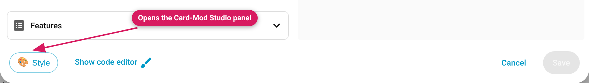

## Requirements

- Home Assistant **2025.9 or newer**, 2026.2 or newer recommended:
  - **Fully tested** on 2026.9.4 and 2026.10.0b0, with card-mod 4.2.1 and
    with UIX 8.3.1 (every control, every card type, light/dark, phone to
    desktop).
  - **Tested** on 2026.11.0 (v0.10.2, and v0.11.0-beta.2 including Mushroom 5.2.3 and Bubble Card 3.4.3) with card-mod 4.2.1 and with UIX 9.0.0.
  - **Partially tested** (quick checks) on 2026.6.4 and 2026.2.3 with
    card-mod 4.2.1 — all controls pass — and on 2025.9.4 with card-mod
    3.4.5, where everything works except that Font doesn't change a *tile*
    card's name/state text.
  - Older than 2025.9 isn't supported: HA's older card editor has no spot
    for the Style button (checked on 2025.3), and the plugin declares 2025.9.0
    as its minimum Home Assistant version.
- On HA 2026.11 and newer, the **Marketplace** (HACS is folded into core
  there); on older HA, HACS
- **card-mod** or **UIX** installed and working — Card-Mod Studio *generates*
  the YAML; one of those two engines *applies* it. Without an engine, styles
  are saved but nothing renders (the panel shows a warning banner in that case).
  Which one to pick? See [card-mod vs UIX](card-mod-vs-UIX) — UIX is the
  actively developed engine, and a drop-in replacement for card-mod.

## Via the Marketplace (HA 2026.11 and newer)

Home Assistant 2026.11 folds HACS into core as the **Marketplace**. A
separate HACS install is no longer possible on 2026.11; existing HACS
installs migrate automatically (custom repositories and update entities
carry over).

1. Open the Marketplace → search for **Card-Mod Studio**
2. Click it → install
3. The Marketplace installs the plugin into `www/community/card-mod-studio/`
   and adds it as a dashboard resource
4. Hard-refresh the browser (Ctrl+Shift+R)

If your dashboard resources are in **YAML mode**, add the resource manually
(see [Manual install](#manual-install)).

## Via HACS (HA before 2026.11)

Card-Mod Studio is in the **HACS default store**:

1. Open HACS → search for **Card-Mod Studio**
2. Click it → **Download**
3. HACS registers the dashboard resource automatically on modern versions
4. Hard-refresh the browser (Ctrl+Shift+R)

> Added it as a custom repository before it was in the default store? Remove
> the old custom-repository entry to avoid a duplicate listing.

### Beta versions

Pre-releases are published as GitHub *pre-releases*. In HACS (HA before
2026.11), open the
Card-Mod Studio entry → ⋮ → **Redownload** → enable *"Show beta versions"*
to opt in. Betas are testing builds — the changelog marks them clearly.

## Manual install

1. Download `card-mod-studio.js` from the
   [latest release](https://github.com/DerTrolli/card-mod-studio/releases/latest)
2. Copy it to `config/www/card-mod-studio.js`
3. **Settings → Dashboards → ⋮ → Resources → + Add Resource**
   - URL: `/local/card-mod-studio.js?v=0.11.0-beta.2`
   - Type: *JavaScript Module*
4. Hard-refresh the browser (Ctrl+Shift+R)

When updating manually, bump the `?v=` query string so browsers don't serve
the cached old bundle.

## Verifying it works

Open any dashboard card in edit mode (pencil icon). You should see a
**🎨 Style** button in the editor footer, next to "Show code editor" (on narrow
phone screens it shows just the 🎨 icon, to leave room for HA's own footer
buttons):

If it's missing, see [Troubleshooting](Troubleshooting-FAQ#the-style-button-doesnt-appear).
