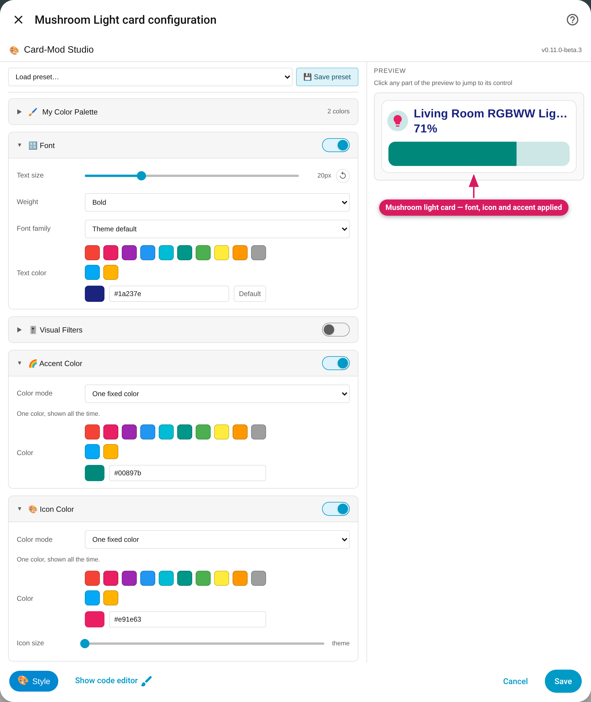

[Mushroom](https://github.com/piitaya/lovelace-mushroom) cards (`custom:mushroom-*-card`) — **new in 0.11 (beta)**. All 18 Mushroom card types have their own set of controls, each one wired to the part of the card it actually reaches. Controls with nothing to reach are hidden, as on every other card.

> Beta: Mushroom support first shipped in v0.11.0-beta.2. It was measured on
> **Mushroom 5.2.3**, **HA 2026.11.0**, **card-mod 4.2.1** and **UIX 9.0.0**
> (identical on both engines): the module-effect audit finds no control that
> changes nothing on any of the 18 types. Other Mushroom versions aren't measured — if a control stops working
> after a Mushroom update, [open an issue](https://github.com/DerTrolli/card-mod-studio/issues).

*Mushroom light card: Font, Icon Color and Accent each change the preview.*

## Which cards

| Group | Card types |
|---|---|
| **Classic state cards** (14) | `alarm-control-panel`, `climate`, `cover`, `entity`, `fan`, `humidifier`, `light`, `lock`, `media-player`, `number`, `person`, `select`, `update`, `vacuum` — e.g. `custom:mushroom-light-card` |
| **Template card** | `custom:mushroom-template-card` — styled like a [tile](Tile-Card) |
| **Chips card** | `custom:mushroom-chips-card` |
| **Title card** | `custom:mushroom-title-card` |
| **Empty card** | `custom:mushroom-empty-card` — draws nothing, so there's nothing to style and the Studio offers no controls |

## Available options

### Classic state cards (14)

| Module | Available | What it styles |
|---|---|---|
| Font | ✅ | **Primary text** (the name) and **secondary text** (the state) together: size, weight, family and colour. A set Text size also sets a matching line height, so large text isn't clipped; a size at or below Mushroom's own (14px) leaves the card at its normal height. Hidden when both text lines are set to none |
| Icon Color | ✅ | The icon's colour, plus an **Icon size** slider (up to 56px) that resizes the icon shape and its glyph together. The default mode is "Keep the card's colour", so changing only the size doesn't force a colour. Hidden when the card sets `icon_type: none` (or the older `hide_icon`) |
| Accent Color | ✅ — hidden when the card sets `icon_color` | The card's **active colour**: icon, icon shape and, on the light card, the brightness slider. Cards that have several states (climate modes, cover open/closed, lock states, …) are coloured for every active state; off, idle and unknown states keep Mushroom's own disabled colour |
| Threshold Colors | ✅ | Icon, Accent, Background, Text and Border colour from a value (Accent follows the Accent rule above) |
| Background | ✅ | The card's background |
| Border & Radius | ✅ | The card's border and corner radius |
| Visual Filters, Animation | ✅ | The whole card |
| Advanced CSS | ✅ | Anything else |

### Template card

Styled like a tile: Font → name and state text, Accent → the tile colour, Icon Color (colour and size), Threshold, Background, Border, Filters and Animation. See the [Tile card](Tile-Card) page for how those behave.

### Chips card

A chips card is a row of small chips, so the controls are chip-shaped:

| Module | Available | What it styles |
|---|---|---|
| Font | ✅ (no text colour) | Chip text size, weight and family. The text colour isn't offered: the only thing that reaches chip text also recolours everything else under it |
| Icon Color | size only | The chips' icon size. The panel says so: the icons can't take a colour from a style |
| Background | ✅ | The chip background |
| Border & Radius | ✅ | Chip border width, colour and corner radius |
| Threshold Colors | Background, Border colour | The other targets have nothing to reach |
| Accent Color | — hidden | Chips have no accent colour |
| Visual Filters, Animation | ✅ | The whole card |

### Title card

Text only; the card paints no box and has no icon.

| Module | Available | What it styles |
|---|---|---|
| Font | ✅ | The **title**: size, weight and colour. The family is inherited, so it also changes the subtitle; the subtitle's size, weight and colour are not touched |
| Threshold Colors | Text colour only | |
| Visual Filters, Animation | ✅ | The whole card |
| Background, Border, Icon Color, Accent Color | — hidden | The title card has no box and no icon, so these do nothing |

## Card-specific behavior

- **Accent needs an exact colour.** Mushroom takes its accent as a red/green/blue triple, so the Studio converts your colour. Hex, `rgb()`, `hsl()`, colour names, HA palette swatches and HA's own theme colours (such as `var(--primary-color)`) convert, and so do colours from [My Color Palette](Presets-and-My-Color-Palette). Transparency is dropped, since Mushroom's accent has none. A colour that can't be converted (for example your own `var(--my-colour)`) isn't written, and the module says so under the colour mode — pick another colour. A colour taken from the palette is stored as a fixed colour (a plain colour written as red/green/blue numbers), so it does **not** follow a later theme change; typing `var(--primary-color)` does.
- **Accent is hidden when the card sets its own `icon_color`** (and, on cards where Accent reaches only the icon, when `icon_type` is `none`). Mushroom then ignores the accent variables or has nothing to colour (measured), so the control would do nothing. Remove `icon_color` from the card's YAML to get Accent back. With a Threshold rule set, the Accent target disappears for the same reason. An Accent you stored earlier is kept and written back while its control is hidden.
- **ON / OFF colours.** Cards whose state is never "on" (alarm panel, cover, lock, climate, person) don't offer a separate ON colour: Icon Color's and Accent's "Different for ON / OFF" says so, and climate offers OFF only.
- **Off states keep their look.** Accent colours what the card shows while active; Mushroom's own disabled colour for off, idle and unknown states is deliberately left alone.
- **Your hand-written CSS is preserved.** Anything on a Mushroom card that the Studio doesn't recognise stays in [Advanced CSS](Advanced-CSS) and is written back unchanged, including your own `!important` rules. Where a hand-written rule overrides a control, that control shows the usual ⚠️ warning.

## Click-to-edit

Point at the preview and the highlight names the control that styles that part; a click jumps to it.

- **Classic cards:** primary and secondary text → Font, the icon (shape and glyph) → Icon Color, anything else on the card → Background.
- **Template card:** the name/state block → Font, the icon → Icon Color.
- **Chips:** a chip's text → Font, its glyph → Icon Color, the rest of the chip → Background.
- **Title card:** the title → Font. The subtitle isn't claimed by any control (the card has no box, so a click on it opens Advanced CSS).

## Limits

- **Tested versions:** Mushroom 5.2.3 on HA 2026.11.0 with card-mod 4.2.1 and UIX 9.0.0 (v0.11.0-beta.2). <!-- QA-PENDING: beta.3 verification result -->
- **Chips:** no text colour and no icon colour (see above).
- **Title card:** the subtitle's size, weight and colour can't be styled from the Studio — use [Advanced CSS](Advanced-CSS).
- **Animation:** Gradient Shift isn't offered on the title card (it has no background to shift).
- **Mushroom cards inside a stack** get their own styling section like any other child — see [Cards Inside Stacks](Styling-Cards-Inside-Stacks).

See also: [Bubble Card](Bubble-Card) · [Card Support & Limits](Card-Support).
