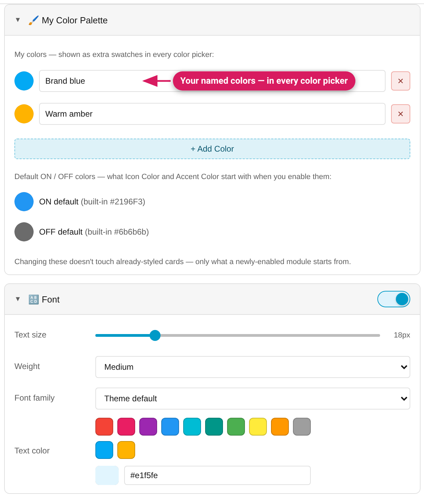

Two features for keeping a consistent look across your dashboard, both
stored **per HA user** in Home Assistant's backend — they sync automatically
to every device and browser logged in as the same user (localStorage is kept
as an instant local fallback).

## Style presets

The bar at the top of the panel:

- **💾 Save preset** — stores the card's *entire* current style
  configuration under a name, typed into the bar itself (Enter saves,
  Escape cancels).
- **📋 Load preset…** — applies a saved preset to any other card, in one
  click. Card-type-specific parts adapt (the same accent preset colors a
  gauge's dial and a tile's tint). Settings the card can't use are left
  out: hidden modules, Font rows the card hides, an animation preset the
  card doesn't offer (Spin on a dial card, Gradient Shift without a
  background).
- **×** — deletes the selected preset; press it a second time to confirm
  (it disarms itself after a few seconds or when you click elsewhere).

A name that already exists is saved only through an explicit **Overwrite**;
new names are limited to 60 characters. Presets saved with text instead of
numbers in a threshold rule or fade point (some older ones) load fine.

If Home Assistant can't be reached, a preset change is kept on this device
and sent to Home Assistant when it is reachable again (the bar tells you it
was "saved on this device only"). If this browser's storage is full too, it
says the change can't be saved.

Loading a preset keeps the current card's hand-written Advanced CSS unless
the preset itself carries Advanced CSS — a preset from a different card
won't silently wipe your custom rules.

## My Color Palette

The **🖌️ My Color Palette** section (below the preset bar):

- **My colors** — named custom colors that appear as an extra swatch row in
  **every** color picker: card modules, threshold rules, fade points, and
  per-row controls alike. Define your brand/theme colors once.
- **Default ON / OFF colors** — override what a freshly-enabled control
  starts with: Icon Color / Accent Color's ON and OFF colors, a new
  threshold rule's color, a new fade point, a row's icon color. Changing
  these never touches already-styled cards — only what *new* controls start
  from. **Reset** returns to the built-ins.

Each entry has a hex field next to the colour box (`#rgb` or `#rrggbb`; text
that isn't a colour is never stored). Removing an entry takes a second press
of the same button. Cards **keep the colour they were given**: a colour is
copied into the style when you pick it, so changing or removing a palette entry
doesn't restyle cards that already use it. Edits are saved to Home Assistant as
you commit them; one made while Home Assistant is unreachable (or just before
you close the tab) is kept and sent later, and the manager says so when it can
only be kept in this browser's memory.

## Where exactly is this stored?

HA's per-user frontend storage (`frontend/set_user_data`) — on the server in
`.storage/frontend.user_data_<user_id>`, not in the browser. No extra
entity, no cloud. Presets saved by old versions are migrated automatically
when loaded by a newer version.
