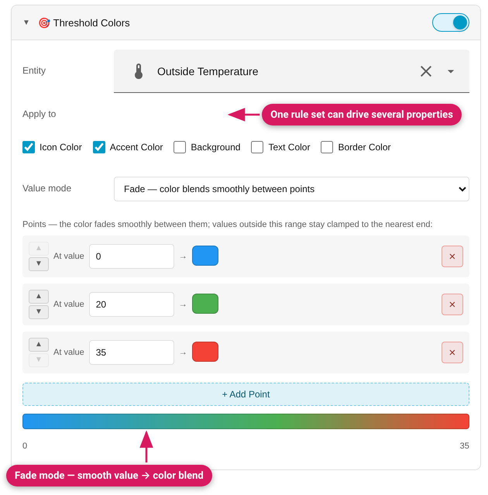

The most powerful module: colors driven by a **live numeric value**, with no
YAML or Jinja2 to write.



## The value source

- **Entity** — any entity, not just the card's own.
- **Value read from** — the entity's *state* by default, or any of its
  **numeric attributes** (e.g. `battery_level`, `current_temperature`,
  `brightness`). The dropdown lists the attributes that currently hold a
  numeric value.

## Apply to — one rule set, several properties

Tick any combination of target properties; they all follow the same rules:

| Property | What it colors |
|---|---|
| Icon Color | The card's main icon |
| Accent Color | The card's accent (tile tint, gauge dial/needle, graph line) |
| Background | The whole card background |
| Text Color | The card's text (on tile cards the name/state text, on chart and list cards the title; on markdown and alarm panel the card title as well) |
| Border Color | A card border (width slider appears when selected) |

The list only offers the colours that actually show on the current card —
the same rules that hide a module elsewhere (e.g. no Accent Color on a
button or light card, no Text Color on an alarm panel). On an **entities**
card only Background, Text Color and Border Color are offered, for the card
as a whole, and the value entity must be picked (the card has none of its
own). See [Card Support](Card-Support).
While Threshold drives a property, the corresponding static module for that
property steps aside automatically — no fighting declarations — and the
module says so (Font shows a hint when Threshold is setting the text colour).

## Step mode (rules)

Each rule is `operator + value → color` (operators: `<` `<=` `>` `>=` `==` `!=`),
plus a **default color** when nothing matches. Rules are evaluated
**first-match-wins** and sorted automatically — enter them in any order; the
**Result legend** at the bottom shows exactly what will happen at every value.

Example — a temperature icon: blue `< 18`, red `>= 25`, default green.

## Fade mode (gradient)

Instead of discrete steps, define **value → color points**; the color blends
smoothly between them and clamps at the ends. A live gradient bar previews
the whole range. Points can be reordered with the ▲/▼ buttons (they swap
colors between value slots).

Under the hood, Fade is approximated as a dense chain of ~32 step rules —
invisible at normal update rates — but **your actual points are what you get
back** when you reopen the editor, not the generated rules.

## Numbers and missing values

The value and rule fields accept a decimal comma (`2,5` is 2.5), and an empty
or invalid entry is not stored: the previous number comes back when you leave
the field. `1,000` is refused rather than read as 1. Values from about
0.000001 up to 1,000,000,000,000,000 are accepted.

If the entity's value is `unavailable`, `unknown` or missing, it counts as 0
in the rules (the generated template reads it with `| float(0)`), so a Fade
shows its lowest colour and a rule such as `<= 12.5` matches. Use an "is not
unavailable" check in your own CSS if that matters.

## Generated YAML

Standard card-mod/UIX Jinja2, e.g.:

```yaml
card_mod:
  style: |
    ha-state-icon {
      color: {{ '#ff0000' if states('sensor.temp') | float(0) >= 25 else '#2196f3' }} !important;
    }
```

Attribute mode uses `state_attr('entity', 'attribute')` instead of
`states(...)`. Both engines render this natively.

## Per-row thresholds

Entities cards support the same rule builder **per entity row** — see
[Entities Card Per-Row Styling](Entities-Card-Per-Row-Styling).
