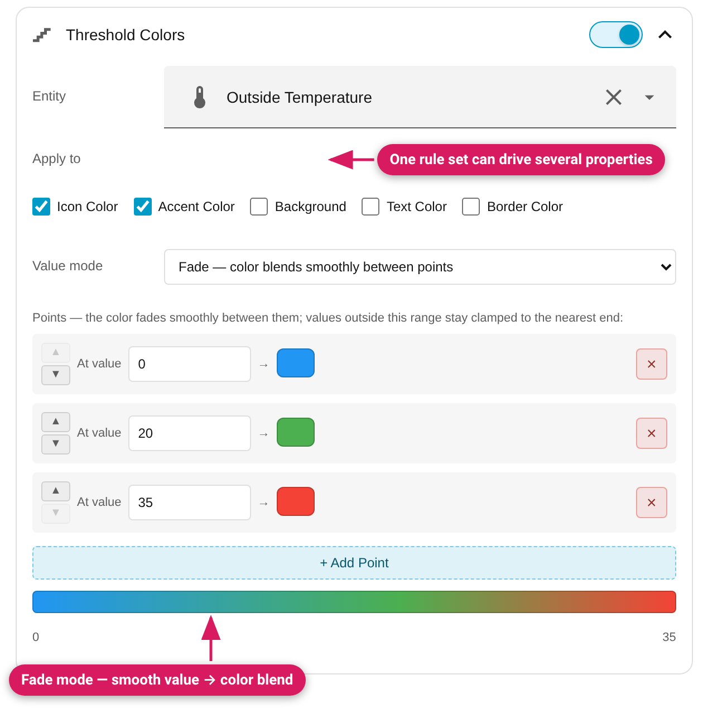

The most powerful module: colors driven by a **live value** (a number, or
since v1.0.0-beta.2 a state's text such as `heating` or `docked`), with no
YAML or Jinja2 to write.



## The value source

- **Entity** — any entity, not just the card's own.
- **Value read from** — the entity's *state* by default, or any of its
  **numeric attributes** (e.g. `battery_level`, `current_temperature`,
  `brightness`). The dropdown lists the attributes that currently hold a
  numeric value.

## Apply to — one rule set, several properties

Tick any combination of target properties; they all follow the same rules:

| Property | What it colors |
|---|---|
| Icon Color | The card's main icon |
| Accent Color | The card's accent (tile tint, gauge dial/needle, graph line) |
| Background | The whole card background |
| Text Color | The card's text (on tile cards the name/state text, on chart and list cards the title; on markdown and alarm panel the card title as well) |
| Border Color | A card border (width slider appears when selected) |

The list only offers the colours that actually show on the current card —
the same rules that hide a module elsewhere (e.g. no Accent Color on a
button or light card, no Text Color on an alarm panel). On an **entities**
card only Background, Text Color and Border Color are offered, for the card
as a whole, and the value entity must be picked (the card has none of its
own). See [Card Support](Card-Support).
While Threshold drives a property, the corresponding static module for that
property steps aside automatically — no fighting declarations — and the
module says so (Font shows a hint when Threshold is setting the text colour).

## Step mode (rules)

Each rule is `operator + value → color` (operators: `<` `<=` `>` `>=` `==` `!=`),
plus a **default color** when nothing matches. Rules are evaluated
**first-match-wins** and sorted automatically — enter them in any order; the
**Result legend** at the bottom shows exactly what will happen at every value.

Example — a temperature icon: blue `< 18`, red `>= 25`, default green.

The sort follows the direction of your first rule: with `<` or `<=` first the
lowest value is checked first, with `>` or `>=` first the highest. Rules
pointing both ways (say `<= 10` and `>= 1`) are kept in that order and come
back as rules when the card is reopened (before v0.11.0, v0.10 and
later showed Threshold Colors switched off with the expression under
Advanced CSS; v0.8 and v0.9 reordered the rules on the next save).

### Text rules: is / is not *(v1.0.0-beta.2)*

Next to the number operators, a rule can compare the value **as text**:
`is` / `is not`, for states that are words rather than numbers. A thermostat's
action — `heating` orange, `cooling` blue, default grey — or a vacuum —
`cleaning` green, `error` red, `docked` grey — or any select, person or
media player. The rules can also read a text attribute (Value read from →
e.g. `hvac_action`); the dropdown offers text attributes while a text rule
exists.

- The text is compared **exactly as Home Assistant stores it**: `heating`, not
  the translated *Heating* / *Heizt* the dashboard shows, and case matters.
  The editor shows the value right now under the rules, and switching a rule
  to `is` fills in the current state.
- Text rules are checked **first**, in the order you entered them, then the
  number rules. That way `is unavailable` works next to `< 5` (a number rule
  reads `unavailable` as 0).
- A number typed into `is` / `is not` becomes the number rule `==` / `!=`,
  which compares the same thing.
- Fade mode stays numbers-only.
- A hand-written chain in exactly this spelling —
  `{{ 'orange' if states('climate.hall') == 'heating' else 'grey' }}` — is now
  read into the module when the card is opened (it stayed in Advanced CSS
  before); any other spelling (`is_state(…)`, double quotes, extra conditions)
  stays hand-written.

## Fade mode (gradient)

Instead of discrete steps, define **value → color points**; the color blends
smoothly between them and clamps at the ends. A live gradient bar previews
the whole range. Points can be reordered with the ▲/▼ buttons (they swap
colors between value slots).

Under the hood, Fade is approximated as a dense chain of ~32 step rules —
invisible at normal update rates — but **your actual points are what you get
back** when you reopen the editor, not the generated rules.

## Numbers and missing values

The value and rule fields accept a decimal comma (`2,5` is 2.5), and an empty
or invalid entry is not stored: the previous number comes back when you leave
the field. `1,000` is refused rather than read as 1. Values from about
0.000001 up to 1,000,000,000,000,000 are accepted.

If the entity's value is `unavailable`, `unknown` or missing, it counts as 0
in the rules (the generated template reads it with `| float(0)`), so a Fade
shows its lowest colour and a rule such as `<= 12.5` matches. Since
v1.0.0-beta.2 a text rule `is unavailable` handles that in the module: it is
checked before the number rules.

## Generated YAML

Standard card-mod/UIX Jinja2, e.g.:

```yaml
card_mod:
  style: |
    ha-state-icon {
      color: {{ '#ff0000' if states('sensor.temp') | float(0) >= 25 else '#2196f3' }} !important;
    }
```

Attribute mode uses `state_attr('entity', 'attribute')` instead of
`states(...)`. Both engines render this natively.

## Per-row thresholds

Entities cards support the same rule builder **per entity row** — see
[Entities Card Per-Row Styling](Entities-Card-Per-Row-Styling).
